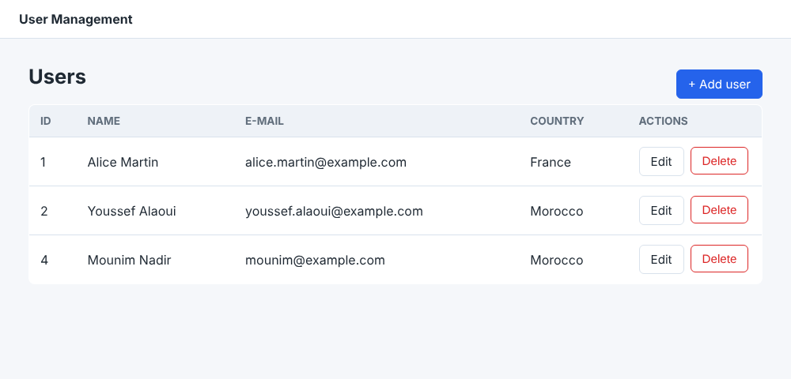
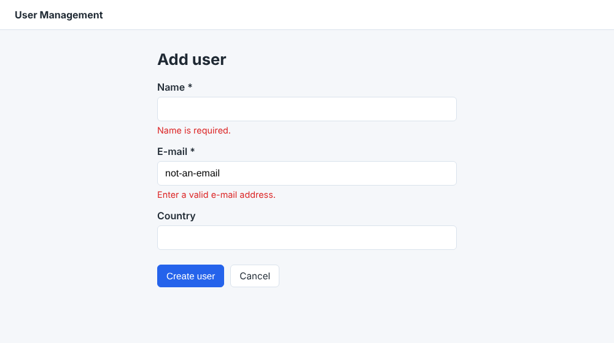

# User Management Web App (Jakarta EE · JDBC · MySQL)

A classic **MVC CRUD web application** written in plain Jakarta EE, with no framework:
Servlets as the controller, JSP/JSTL as the views, and JDBC with MySQL for persistence.
It was built with a **secure-by-default** approach: every input is validated on the server and every output is escaped,
and the main OWASP Top 10 risks for this kind of app are addressed.



## Features

- **Create, list, edit and delete** users (name, e-mail, country)
- Server-side **input validation** with inline error messages
- Flash messages after each action (Post/Redirect/Get pattern)
- Friendly error pages (400 / 403 / 404 / 405 / 500) that never leak stack traces



## Security measures

| Risk | Mitigation | Where |
|---|---|---|
| SQL injection | `PreparedStatement` with bound parameters for every query | `UserDAO` |
| Cross-site scripting (XSS) | All dynamic values rendered with `<c:out>` (HTML-escaped) | JSP views |
| Cross-site request forgery (CSRF) | Per-session random token (`SecureRandom`, 256 bits), checked with a constant-time comparison on every POST | `CsrfTokens`, forms |
| Unsafe HTTP methods | State-changing actions accept **POST only**; GET returns 405 | `UserServlet` |
| Hard-coded secrets | DB credentials read from environment variables | `ConnectionFactory` |
| Clickjacking / MIME sniffing | `X-Frame-Options`, `Content-Security-Policy`, `X-Content-Type-Options`, `Referrer-Policy` headers | `SecurityHeadersFilter` |
| Session hijacking via JS | Session cookie is `HttpOnly`, cookie-only session tracking | `web.xml` |
| Information disclosure | Generic error pages; JSPs are under `WEB-INF/` (not directly reachable) | `error.jsp`, `web.xml` |

## Architecture

```
Browser ──HTTP──► SecurityHeadersFilter ──► UserServlet (Controller)
                                              │        │
                                    validates │        │ forwards
                                              ▼        ▼
                                     UserValidator   JSP views (WEB-INF/views)
                                              │
                                              ▼
                                       UserDAO ──JDBC──► MySQL (users table)
                                              ▲
                                     ConnectionFactory (env-based config)
```

| Layer | Class / file | Role |
|---|---|---|
| Model | `usermanagement.model.User` | JavaBean (id, name, email, country) |
| DAO | `usermanagement.dao.UserDAO` | CRUD queries |
| DAO | `usermanagement.dao.ConnectionFactory` | JDBC connections from env config |
| Controller | `usermanagement.web.UserServlet` | Routing and request handling |
| Controller | `usermanagement.web.UserValidator` | Server-side validation |
| Controller | `usermanagement.web.CsrfTokens` | CSRF token generation and check |
| Filter | `usermanagement.web.SecurityHeadersFilter` | HTTP security headers |
| Views | `user-list.jsp`, `user-form.jsp`, `error.jsp` | JSP + JSTL 3.0 |

### Routes

| Method | Path | Action |
|---|---|---|
| GET | `/` or `/list` | List all users |
| GET | `/new` | Empty creation form |
| GET | `/edit?id={id}` | Edit form for one user |
| POST | `/insert` | Create a user |
| POST | `/update` | Update a user |
| POST | `/delete` | Delete a user |

## Tech stack

- Java 21
- Jakarta Servlet 6.0 / JSP / JSTL 3.0
- Apache Tomcat 10.1
- MySQL 8 with MySQL Connector/J 8.4
- Eclipse IDE (Dynamic Web Project)

## Getting started

### 1. Create the database

```bash
mysql -u root -p < UserManagement/sql/schema.sql
```

It's best to create a dedicated user with minimal privileges instead of using `root`:

```sql
CREATE USER 'umapp'@'localhost' IDENTIFIED BY 'change-me';
GRANT SELECT, INSERT, UPDATE, DELETE ON usermanagement.* TO 'umapp'@'localhost';
```

### 2. Configure the connection

The app reads these environment variables (the defaults are meant for local development):

| Variable | Default |
|---|---|
| `DB_URL` | `jdbc:mysql://localhost:3306/usermanagement` |
| `DB_USER` | `root` |
| `DB_PASSWORD` | *(empty)* |

In Eclipse: **Servers → Tomcat → Open launch configuration → Environment**.

### 3. Run

1. Import `UserManagement/` into Eclipse (**File → Import → Existing Projects into Workspace**).
2. Add an **Apache Tomcat 10.1** server runtime.
3. **Run As → Run on Server**, then open <http://localhost:8080/UserManagement/>.

The required libraries (JSTL 3.0, MySQL Connector/J) are already in `src/main/webapp/WEB-INF/lib/`.

## Project structure

```
UserManagement/
├── sql/schema.sql
└── src/main/
    ├── java/usermanagement/
    │   ├── model/User.java
    │   ├── dao/ConnectionFactory.java
    │   ├── dao/UserDAO.java
    │   └── web/
    │       ├── UserServlet.java
    │       ├── UserValidator.java
    │       ├── CsrfTokens.java
    │       └── SecurityHeadersFilter.java
    └── webapp/
        ├── css/style.css
        ├── js/confirm.js
        └── WEB-INF/
            ├── web.xml
            ├── lib/
            └── views/ (user-list.jsp, user-form.jsp, error.jsp)
```

## Possible improvements

- Connection pooling (Tomcat JDBC pool via JNDI `DataSource`)
- Pagination and search on the user list
- Unique constraint on e-mail and duplicate handling
- Authentication and role-based access (admin vs read-only)
- Maven/Gradle build and automated tests (JUnit + Testcontainers)

## Authors

- **Mounim Nadir**
- **Anass Ighachouten**
